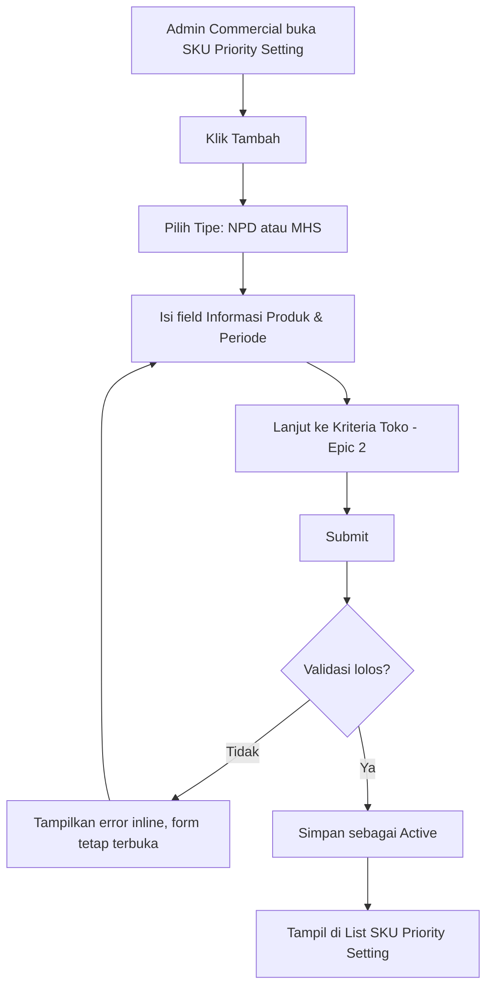
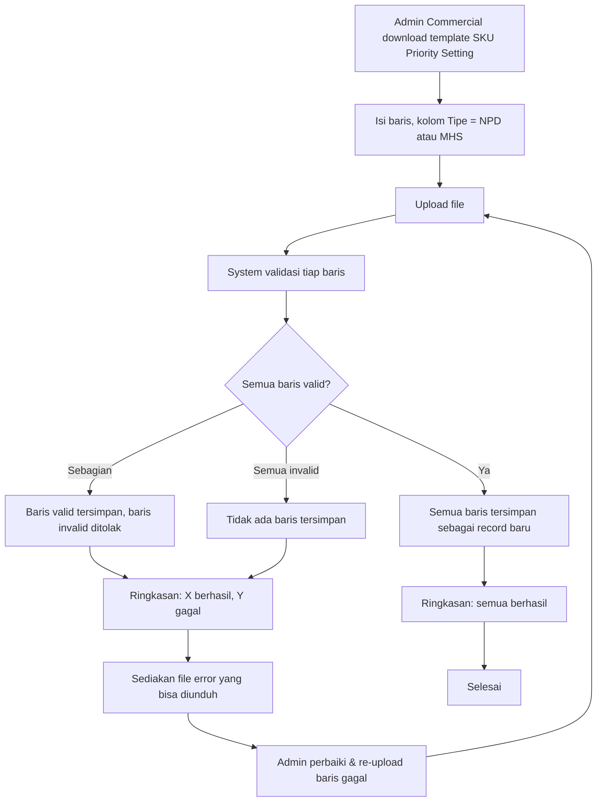
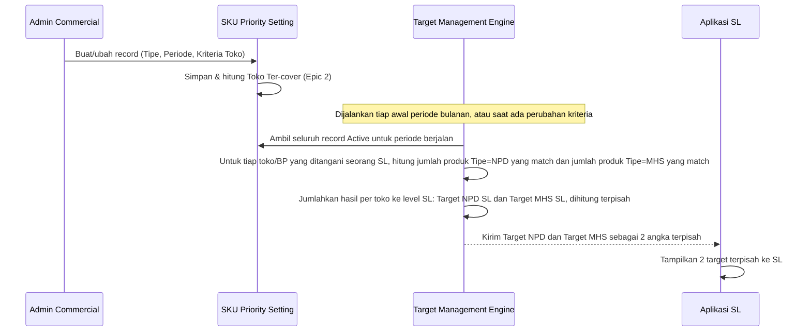

# URS - Unifikasi NPD & MHS Setting (SKU Priority Setting)

Oct 15, 2026 · @@Muchamad Lutfi Maulana

URS ini mencakup unifikasi struktur data & UI NPD Setting dan MHS Setting menjadi satu modul SKU Priority Setting (field Tipe = NPD/MHS), termasuk builder kriteria toko yang sama untuk keduanya, periode bulanan untuk MHS, import gabungan, dan migrasi data existing, serta kontrak integrasi akumulasi target ke Target Management Store Leader (SL). Di luar scope fase ini: approval workflow berjenjang, auto-suggest kriteria dari data historis toko, targeting engine generik lintas use case (Opsi C dari Opportunity Brief), dan perubahan cara Target Management SL menghitung/menampilkan target (tetap 2 angka terpisah: NPD & MHS).

## General Information

| Field | Value |
| --- | --- |
| Short Description | Unifikasi NPD Setting & MHS Setting menjadi 1 modul "SKU Priority Setting" (Tipe = NPD/MHS) dengan struktur periode & kriteria toko yang sama; tidak termasuk approval workflow dan perubahan perhitungan Target Management SL |
| Date of Submission | TBD |
| Requester | TBD |
| Directorate Requestor | Commercial |
| Business Process | Sales Target Management / Field Sales Operations |
| Business Process Owner | TBD |
| Need changes in Master Data? | Yes — struktur record NPD Setting & MHS Setting lama dimigrasi ke struktur baru SKU Priority Setting |
| Triggered Financial Transactions? | No |
| Entity | TBD (Paragon group — mengacu ke master produk pada prototype) |
| Impacted Applications | SFA Backoffice (menu NPD Setting & MHS Setting digabung jadi SKU Priority Setting), Target Management SL (konsumen data, lihat Epic 4) |
| Need new dashboard? | Not this phase |
| Expected Go Live | TBD |
| Need UI/UX? | Yes |
| Need Support from BAOD? | TBD |

## Modification History & Approval

### Modification History

| Version | Updated By | Change History | Date |
| --- | --- | --- | --- |
| 00 | TBD | Initial Document — URS Unifikasi NPD & MHS Setting (SKU Priority Setting) | TBD |
| 01 | TBD | Resolved 5 open questions (Requester confirmed): Store Type MHS digantikan kriteria granular; periode migrasi MHS = bulan berjalan; master mapping Store Type bisa diakses; record periode lewat read-only; perubahan kriteria langsung memicu recompute target SL | 2026-10-15 |
| 02 | TBD | Finalization pass ahead of prototyping: logged 4 remaining open questions (toggle UX, duplicate-row validation, SL handover mid-period, Commercial Lead permission) into the Assumption table for traceability. No business-rule changes. | 2026-10-15 |
| 03 | TBD | Ditambahkan atas permintaan requester: (1) 1 record SKU Priority Setting bisa memuat lebih dari satu Produk atas kriteria toko yang sama; (2) validasi tumpang tindih kriteria toko lintas record (Epic 2 Task 2.3); (3) detail view dipecah jadi tab General Info & Applied Scope (Epic 1 Task 1.4), mengikuti pola ERP Rule detail yang sudah ada di SFA Backoffice. | 2026-10-22 |

### Approval / Sign-Off

| Name | Title | Date |
| --- | --- | --- |
| TBD | TBD | TBD |

## Project Deliverable & Benefit

### Project Deliverable

- 1 modul SKU Priority Setting menggantikan NPD Setting & MHS Setting, dengan field Tipe (NPD/MHS) untuk membedakan kategori SKU prioritas dan target yang dihitung (lihat Epic 4).
- Builder kriteria toko (DC/Channel/Outlet Type/Partner Include-Exclude) yang identik untuk NPD dan MHS, dengan preview jumlah toko ter-cover secara real-time.
- Dimensi Periode (Bulan/Tahun) berlaku untuk NPD maupun MHS.
- 1 template import gabungan untuk NPD & MHS.
- Migrasi otomatis seluruh data NPD Setting & MHS Setting existing ke struktur baru.
- Kontrak integrasi yang jelas ke Target Management SL: target NPD dan target MHS tetap dihitung & ditampilkan terpisah, diakumulasi dari seluruh toko yang ditangani tiap SL.

### Quantitative Benefit (Annual)

| Item | Y1 Target | Details Calculation |
| --- | --- | --- |
| Waktu setting NPD+MHS per bulan oleh Admin Commercial | *(Open question for Requester: berapa baseline waktu saat ini? Assumed: belum ada data, perlu diukur sebelum & sesudah rilis, pending confirmation.)* | Dari 2 alur kerja terpisah jadi 1 alur; diukur lewat time-tracking sederhana sebelum/sesudah go-live |
| Jumlah template import yang perlu dipelajari Admin Commercial | Turun dari 2 jadi 1 | Penggabungan `template_import_partner_npd_setting.csv` dan `template_import_mhs_item` jadi 1 format |

### Qualitative Benefit

| Benefit | Description |
| --- | --- |
| 1 sumber kebenaran kriteria toko | Tidak ada lagi 2 cara berbeda untuk menentukan "toko mana yang eligible" antara NPD dan MHS |
| Konsistensi periode | MHS ikut punya dimensi Bulan/Tahun, selaras dengan siklus Target Management SL yang juga bulanan |
| Lebih mudah di-maintain | 1 struktur data, 1 set komponen UI, 1 template import — mengurangi beban maintenance jangka panjang |

### Cost of Doing Nothing (Annual)

| Item | Potential Impact | Details Calculation |
| --- | --- | --- |
| Ketidaksinkronan kriteria toko NPD vs MHS terus terjadi | Medium | Tidak terukur langsung, tapi berisiko salah target SL yang baru ketahuan setelah komplain Area Manager/SL |
| Biaya maintenance 2 struktur & 2 template semakin menumpuk | Low–Medium | Setiap perubahan kebijakan targeting harus diterapkan 2 kali, di 2 tempat berbeda |

## Risk & Assumption

### Risk

| # | Risk Description | Potential Impact | Significance | Mitigation Plan |
| --- | --- | --- | --- | --- |
| 1 | Migrasi data MHS existing (belum punya periode) salah diisi periodenya | Target SL untuk bulan-bulan awal jadi tidak akurat | High | Dry-run migrasi di staging, bandingkan hasil target SL sebelum/sesudah untuk minimal 1 bulan histori sebelum go-live |
| 2 | Admin Commercial kesulitan memakai builder kriteria toko yang lebih kompleks dibanding sekadar memilih Store Type | Adopsi rendah, salah setting kriteria, target SL tidak akurat | Medium | User testing prototype dengan 2-3 Admin Commercial sebelum development penuh; sediakan default/preset kriteria umum |
| 3 | Proses lain (laporan Commercial, integrasi lain) masih bergantung ke struktur MHS lama (Store Type) dan belum di-update | 2 sumber data hidup berdampingan, data tidak konsisten | Medium | Inventarisasi semua konsumen data MHS existing sebelum skema final disepakati |
| 4 | Admin Commercial kesulitan mengelola multi-produk dalam 1 record (tambah/hapus produk, mencari produk di antara banyak pilihan) | Adopsi rendah, salah pilih produk, record jadi campur-aduk | Medium | Sediakan multi-select dengan search & chip yang jelas; user testing khusus alur tambah banyak produk sekaligus |
| 5 | Validasi tumpang tindih kriteria toko (Task 2.3) menghitung ulang cakupan toko tiap submit — berpotensi lambat kalau master toko besar | Form lambat/freeze saat submit, UX buruk | Medium | Hitung di backend secara asinkron dengan indikator loading; cache hasil perhitungan toko per kombinasi kriteria yang sering dipakai |

### Assumption

| # | Assumption Description | Validation Plan |
| --- | --- | --- |
| 1 | Target NPD dan target MHS tetap dihitung & ditampilkan terpisah ke SL (tidak digabung jadi 1 angka) | Dikonfirmasi oleh Requester saat framing masalah; divalidasi ulang ke beberapa SL/Area Manager soal kejelasan UX sebelum go-live |
| 2 | Store Type MHS (MHS-A..E) akan digantikan sepenuhnya oleh kriteria toko granular (DC/Channel/Outlet Type/Partner), bukan dipertahankan sebagai lapisan tambahan | *Dikonfirmasi requester: Store Type MHS-A..E digantikan sepenuhnya oleh kriteria toko granular (DC/Channel/Outlet Type/Partner).* |
| 3 | Master mapping toko ↔ Store Type/Outlet Type yang disebut requester sudah tersedia dan bisa diakses sebagai referensi, tidak perlu dibangun ulang di epic ini | Dikonfirmasi requester: master mapping ini bisa diakses. Detail lokasi & format data dikonfirmasi lebih lanjut saat development. |
| 4 | Dikonfirmasi requester: Kriteria Toko (Epic 2) memakai 1 filter builder tunggal (rule-based, default "Semua Toko") menggantikan pola 3 toggle independen | Dikonfirmasi requester saat prototyping |
| 5 | Duplikat antar baris dalam 1 file import (Epic 3) cukup divalidasi per-baris terhadap data tersimpan, bukan dideteksi di level file | Konfirmasi ke IT Engineer saat development |
| 6 | Toko yang berpindah dari SL A ke SL B di tengah periode (Epic 4) mengikuti aturan assignment yang sudah ada di Target Management, tidak didefinisikan ulang di sini | Konfirmasi ke pemilik modul Target Management |
| 7 | Commercial Lead hanya punya akses View (bukan Create/Edit) untuk rilis ini, karena approval workflow ditunda | Konfirmasi ke Commercial Lead/Requester |

## Current State (as-is)

- NPD Setting: 1 record = 1 produk x 1 periode (Bulan/Tahun), dengan Tipe (Single Variant/Multivariant), toggle cakupan DC/Channel/Outlet Type (independen satu sama lain), opsi Benchmark (Odoo Code/SKU Benchmark), dan Partner Include/Exclude. Validasi: 1 produk tidak boleh punya 2 NPD Setting aktif di bulan & tahun yang sama.
- MHS Setting: 1 record hanya memetakan Produk ke Store Type (MHS-A..E, label tetap), tanpa periode dan tanpa kriteria toko yang terlihat di layar yang sama. Validasi: 1 produk tidak boleh terdaftar 2x pada Store Type yang sama.
- Kedua modul memakai 2 template import terpisah (`template_import_partner_npd_setting.csv` dan `template_import_mhs_item`) dan tidak berbagi struktur data meski secara konsep sama-sama "produk prioritas yang ditargetkan ke toko tertentu".
- Target Management SL mengakumulasi target NPD dan target MHS dari seluruh toko yang ditangani SL tersebut, dan menampilkannya sebagai 2 angka terpisah (bukan digabung).

## Epic 1: SKU Priority Setting — Setup & Management

**Description.** Satu modul CRUD yang menggantikan NPD Setting dan MHS Setting. Setiap record punya field Tipe (NPD/MHS) yang menentukan kategori SKU prioritas dan ke target mana ia dihitung (Target NPD atau Target MHS, lihat Epic 4); field lain (Daftar Produk — bisa lebih dari satu produk sekaligus, Periode, Status, Kriteria Toko, Partner) sama persis untuk kedua Tipe. Field Varian/Basepack (Single Variant/Multivariant) dan Benchmark yang ada di NPD Setting existing dihapus dari scope — tidak relevan untuk kondisi saat ini (dikonfirmasi requester). Epic ini tidak mencakup builder kriteria toko (Epic 2), import/migrasi (Epic 3), atau logika akumulasi ke Target Management SL (Epic 4).

**Objective**

- Admin Commercial bisa membuat, mengubah, dan melihat SKU Priority Setting untuk Tipe NPD maupun MHS lewat 1 alur kerja yang sama.
- MHS punya dimensi Periode (Bulan/Tahun) yang sebelumnya tidak ada.

### User/System Flow

Admin Commercial memilih Tipe lebih dulu, lalu field yang muncul menyesuaikan Tipe tersebut sebelum masuk ke validasi dan penyimpanan.

**Requirements**

**Task 1.1: Buat SKU Priority Setting baru** — As an Admin Commercial, I want to create a new SKU Priority Setting by choosing Tipe (NPD/MHS) and filling the relevant fields, so that a product's priority targeting is recorded in one consistent structure regardless of Tipe.

Acceptance Criteria:

1. Access & Permission
   1. Hanya role dengan akses sesuai Permission Summary yang bisa membuka "Tambah SKU Priority Setting".
2. Input
   1. Field Tipe wajib diisi, opsi: NPD, MHS.
   2. Field Produk wajib, bisa memilih lebih dari satu produk sekaligus (multi-select) atas kriteria yang sama, dicari berdasarkan kode atau nama; minimal 1 produk.
   3. Field Bulan dan Tahun wajib diisi untuk kedua Tipe (perubahan dari kondisi MHS saat ini yang belum punya periode).
   4. Field Status (toggle Active/Inactive), default Active.
3. Validation
   1. Validasi duplikat kini berbasis tumpang tindih kriteria toko, bukan lagi sekadar "1 produk = 1 record" (lihat Epic 2 Task 2.3: Validasi Tumpang Tindih Kriteria Toko) — produk yang sama boleh muncul di lebih dari 1 record dengan Tipe & Periode yang sama selama Kriteria Toko-nya tidak saling tumpang tindih.
4. Save
   1. Setelah berhasil disimpan, record langsung tampil di list view dengan status sesuai yang diset.
   2. Write Date dan user pembuat dicatat untuk audit trail.
5. Page State
   1. Empty state: form kosong dengan placeholder, Tipe belum dipilih.
   2. Loading state saat master data (Produk, dsb.) sedang diambil.
   3. Error state: pesan error inline per field; error duplikat menyebutkan ID record yang konflik.
6. Out of Scope
   1. Approval workflow berjenjang sebelum record menjadi Active (ditunda ke rilis berikutnya, lihat Opportunity Brief).
   2. Auto-generate draft record dari flag "new launch" di master produk (ditunda).
   3. Pembedaan Tipe produk Single Variant/Multivariant dan fitur Benchmark SKU — dihapus dari scope atas permintaan requester, tidak relevan untuk kondisi saat ini.

**Task 1.2: Ubah SKU Priority Setting** — As an Admin Commercial, I want to edit an existing SKU Priority Setting, so that I can correct or update its period, criteria, or status without recreating it.

Acceptance Criteria:

1. Access & Permission
   1. Hanya role dengan akses Edit (Permission Summary) yang bisa membuka form Ubah.
2. Input & Validation
   1. Field Tipe terkunci (tidak bisa diubah) setelah record dibuat; Daftar Produk BISA ditambah atau dikurangi saat edit (minimal 1 produk tersisa) — konsisten dengan penguncian Tipe di NPD Setting saat ini.
   2. Aturan validasi duplikat (Task 1.1) berlaku sama saat edit.
   3. *Dikonfirmasi requester: record dengan Periode yang sudah lewat (bulan berjalan sudah lanjut) bersifat read-only — hanya bisa dilihat, tidak bisa diubah.*
3. Save
   1. Perubahan tercatat di Write Date & audit trail yang sama dengan pembuatan record.
4. Out of Scope
   1. Retroactive recompute otomatis ke target SL yang sudah terbentuk dari periode sebelumnya (lihat Epic 4).

**Task 1.3: Lihat Detail & Daftar SKU Priority Setting** — As an Admin Commercial, I want to search, filter, and view SKU Priority Setting records in one unified list, so that I don't need to switch between two separate screens for NPD and MHS.

Acceptance Criteria:

1. Access & Permission
   1. Hanya role dengan akses View (Permission Summary) yang bisa membuka list & detail.
2. List & Filter
   1. Kolom list: ID, Tipe (tag NPD/MHS), Produk (nama produk pertama + "+N lainnya" bila lebih dari satu), Periode, cakupan Kriteria Toko (lihat Epic 2), Status, Write Date, Action.
   2. Filter tersedia untuk Tipe, Bulan, Tahun, Status; search berdasarkan kode/nama produk.
3. Page State
   1. Empty state: belum ada record sama sekali — tampilkan pesan + tombol Tambah.
   2. Empty search result: filter/pencarian tidak menemukan hasil — tampilkan pesan + opsi Hapus Filter.
   3. Loading state saat data sedang diambil.

**Task 1.4: Lihat Detail SKU Priority Setting (General Info & Applied Scope)** — As an Admin Commercial, I want to view a SKU Priority Setting's detail split into "General Info" and "Applied Scope" tabs, so that I can quickly separate the setting's basic data from exactly which stores it applies to, matching the pattern already used elsewhere in SFA Backoffice (mis. ERP Rule detail).

Acceptance Criteria:

1. Layout
   1. Dibuka dari tombol Detail di list (Task 1.3). Header menampilkan: Nama/ID Setting, tag Status (Aktif/Tidak Aktif), subheader "SKU Priority Setting ID: ... · Tipe: ... · Created: ... · Updated: ...".
   2. Dua tab: "General Info" (default aktif saat dibuka) dan "Applied Scope".
2. Tab General Info
   1. Menampilkan seluruh field skalar: ID, Tipe, Daftar Produk (kode + nama, ditampilkan sebagai list bila lebih dari satu), Bulan, Tahun, Status, Terakhir Diubah, Diubah Oleh.
3. Tab Applied Scope
   1. Search box untuk mencari nilai kriteria di dalam tabel yang sedang ditampilkan (opsional, tidak wajib).
   2. Satu pill per dimensi (DC, Customer Channel, Outlet Type, Partner Include, Partner Exclude), masing-masing dengan badge angka = jumlah nilai aktif di dimensi tersebut; badge 0 berarti dimensi itu tidak dibatasi ("Semua").
   3. Jika seluruh dimensi bernilai 0 (default "Semua Toko", tanpa rule sama sekali), tampilkan banner info "Aturan ini berlaku untuk semua toko" dan sembunyikan tabel nilai.
   4. Memilih satu pill dimensi menampilkan tabel No/Kode/Nama berisi nilai-nilai dimensi tersebut.
4. Out of Scope
   1. Mengubah kriteria langsung dari tab Applied Scope — perubahan kriteria tetap lewat form Ubah (Task 1.2 bersama Epic 2 Task 2.1).

### Reference: Field Structure per Tipe

| Grup Field | Field | NPD | MHS |
| --- | --- | --- | --- |
| Informasi Produk | Tipe, Daftar Produk (≥1, multi-select) | Wajib, terkunci setelah create | Wajib, terkunci setelah create |
| Periode & Status | Bulan, Tahun, Status | Wajib | Wajib (baru) |

## Epic 2: Store Targeting Criteria & Coverage Preview

Komponen "Kriteria Toko" berbasis rule filter yang identik dipakai oleh Tipe NPD maupun MHS di dalam form SKU Priority Setting (Epic 1). Secara default sebuah SKU Priority Setting berlaku untuk "Semua Toko"; Admin Commercial bisa menambahkan satu atau lebih rule filter (Dimensi + Nilai) yang saling AND satu sama lain untuk mempersempit cakupan, ditambah Partner Include/Exclude sebagai override final di level toko individual. Pola 1 filter builder ini menggantikan 3 toggle independen (DC/Channel/Outlet Type) yang dipakai NPD Setting saat ini. Epic ini juga menambahkan 1 kapabilitas baru yang belum ada di kondisi existing: preview jumlah toko & SL ter-cover secara real-time saat rule diisi, supaya Admin Commercial langsung tahu dampak sebelum submit. Epic ini tidak mencakup pembuatan master data toko/hierarchy itu sendiri — hanya membaca & menghitung dari master yang sudah ada.

**Objective**

- Kriteria toko NPD & MHS memakai 1 komponen & 1 cara kerja yang sama, bukan 2 cara berbeda seperti kondisi existing.
- Admin Commercial bisa melihat estimasi dampak (jumlah toko & SL) sebelum submit, mengurangi risiko salah kriteria yang baru ketahuan setelah target SL ter-generate.

### User/System Flow

Admin Commercial menambahkan rule filter satu per satu (Dimensi: DC/Customer Channel/Outlet Type + Nilai); tanpa rule berarti "Semua Toko". Begitu rule berubah, system langsung menghitung ulang estimasi cakupan toko.

```mermaid
flowchart LR
  A[Admin Commercial buka Kriteria Toko]
  B{Ada rule filter?}
  C[Semua Toko - default]
  D[Tambah rule - pilih Dimensi]
  E[Pilih Nilai untuk Dimensi]
  F{Tambah rule lagi?}
  G[Opsional - isi Partner Include/Exclude]
  H[System hitung ulang Toko Ter-cover]
  I[Tampilkan jumlah toko & SL]
  J{Hasil 0 Toko?}
  K[Tampilkan Peringatan]
  L{Kriteria sesuai?}
  M([Kembali ke Form])
  N([Lanjut Submit])

  A --> B
  B -->|"Tidak"| C
  C --> G
  B -->|"Ya"| D
  D --> E
  E --> F
  F -->|"Ya"| D
  F -->|"Tidak"| G
  G --> H
  H --> I
  I --> J
  J -->|"Ya"| K
  K --> L
  J -->|"Tidak"| L
  L -->|"Tidak"| M
  L -->|"Ya"| N

  classDef startEnd fill:#CDF4D3,stroke:#66D575
  classDef process fill:#C2E5FF,stroke:#3DADFF
  classDef decision fill:#FFECBD,stroke:#FFC943
  classDef warnStyle fill:#FFE0C2,stroke:#FF9E42

  class C,M,N startEnd
  class D,E,G,H,I process
  class B,F,J,L decision
  class K warnStyle
```

**Requirements**

**Task 2.1: Tentukan Kriteria Toko** — As an Admin Commercial, I want to define which stores a SKU Priority Setting applies to using a single rule-based filter builder (add filter rules by dimension and value, defaulting to all stores), instead of several separate toggles, so that defining "which stores are eligible" is simple and consistent whether the Tipe is NPD or MHS.

Acceptance Criteria:

1. Input
   1. Default tanpa rule apa pun = "Semua Toko" (semua toko eligible).
   2. Admin bisa menambahkan rule filter; tiap rule terdiri dari Dimensi (pilihan: DC, Customer Channel, Outlet Type) dan Nilai (multi-select sesuai Dimensi yang dipilih).
   3. Admin bisa menambahkan lebih dari 1 rule; antar rule digabung dengan logika AND (mis. DC = X DAN Outlet Type = Y).
   4. Admin bisa menghapus rule yang sudah ditambahkan; menghapus semua rule mengembalikan ke default "Semua Toko".
   5. Field Partner Include dan Partner Exclude tetap terpisah dari rule filter di atas — berfungsi sebagai override final di level toko/partner individual, berlaku untuk kedua Tipe.
2. Validation
   1. Satu Dimensi tidak boleh dipakai di lebih dari 1 rule aktif sekaligus — mengubah Nilai pada Dimensi yang sama meng-update rule yang sudah ada, bukan menambah rule baru.
   2. Partner yang sama tidak boleh ada di Include dan Exclude sekaligus pada 1 record yang sama.
3. Out of Scope
   1. Logika OR antar rule atau pengelompokan rule bersarang (nested) — rilis pertama hanya AND datar.
   2. Tag-based targeting lintas hierarchy (ditunda, lihat Opportunity Brief).

**Task 2.2: Lihat Preview Toko & SL Ter-cover** — As an Admin Commercial, I want to see a real-time estimate of how many stores and Store Leaders match my criteria while I'm filling the form, so that I can catch a misconfiguration (e.g. criteria that match 0 stores) before saving.

Acceptance Criteria:

1. Behaviour
   1. Setiap kali kriteria (DC/Channel/Outlet Type/Partner) berubah, system menghitung ulang dan menampilkan jumlah toko dan jumlah SL unik yang cocok, tanpa perlu submit form.
   2. Jika hasil hitung = 0 toko, tampilkan peringatan non-blocking ("Kriteria ini tidak cocok dengan toko manapun saat ini") — tidak mencegah submit, hanya mengingatkan.
2. Page State
   1. Loading indicator singkat saat perhitungan berjalan (mis. skeleton angka) agar Admin tidak mengira form macet.
   2. Jika data master toko gagal diambil, tampilkan pesan error non-blocking dan biarkan Admin tetap bisa submit (preview bersifat informasional, bukan validasi wajib).
3. Out of Scope
   1. Simulasi "what if" yang menyimpan skenario sebelum commit (ditunda, lihat Opportunity Brief ide #14).

**Task 2.3: Validasi Tumpang Tindih Kriteria Toko** — As the system, I want to block saving a SKU Priority Setting whose store criteria overlaps with another active record sharing the same Tipe, a Produk, and Periode, so that no store ever ends up matched by two conflicting settings for the same product at the same time.

Acceptance Criteria:

1. Behaviour
   1. Saat submit (create maupun edit), system membandingkan record yang sedang disimpan dengan seluruh record Active lain yang: Tipe sama, Periode (Bulan+Tahun) sama, dan memiliki minimal 1 Produk yang sama (irisan Daftar Produk tidak kosong).
   2. Untuk tiap pasangan record yang memenuhi syarat di atas, system menghitung toko yang cocok dengan kriteria masing-masing (Task 2.2) dan memeriksa apakah ada toko yang cocok dengan keduanya (irisan toko tidak kosong).
   3. Jika irisan toko tidak kosong, submit ditolak dengan pesan error yang menyebutkan ID record yang konflik, produk yang tumpang tindih, dan contoh toko yang kena dampak.
   4. Jika irisan toko kosong (kriteria benar-benar terpisah, mis. DC berbeda), submit diperbolehkan meski Tipe + Produk + Periode sama.
2. Validation
   1. Pengecekan ini berjalan di tambah manual (Task 1.1), ubah (Task 1.2), maupun import bulk (Epic 3 Task 3.1) — konsisten di ketiga jalur masuk data.
3. Page State
   1. Error ditampilkan sebagai banner di atas form (bukan error per-field), karena sumber konfliknya ada di record lain, bukan di field manapun di form ini.
4. Out of Scope
   1. Resolusi otomatis (mis. auto-split kriteria supaya tidak overlap) — Admin Commercial menyelesaikan konflik secara manual dengan mengubah kriteria salah satu record.

### Reference: Dimensi Kriteria Toko

| Dimensi | Nilai | Catatan |
| --- | --- | --- |
| DC | Daftar DC (multi-select) | Rule opsional; tanpa rule = semua DC |
| Customer Channel | Daftar Channel (multi-select) | Rule opsional; tanpa rule = semua channel |
| Outlet Type | Daftar Outlet Type (multi-select) | Rule opsional; tanpa rule = semua outlet type |
| Partner (Include/Exclude) | Daftar Partner (multi-select) | Bukan bagian dari rule filter; override terpisah, selalu opsional |

Berlaku untuk Tipe NPD maupun MHS.

## Epic 3: Import, Validation & Data Migration

**Description.** Satu template import gabungan untuk SKU Priority Setting (menggantikan `template_import_partner_npd_setting.csv` dan `template_import_mhs_item`), dengan kolom Tipe yang menentukan kolom mana yang wajib diisi per baris. Epic ini juga mencakup migrasi satu-kali (one-time) seluruh data NPD Setting & MHS Setting existing ke struktur baru.

**Objective**

- Admin Commercial hanya perlu mempelajari 1 format import, bukan 2.
- Tidak ada data NPD/MHS existing yang hilang saat berpindah ke struktur baru.

### User/System Flow

**Requirements**

**Task 3.1: Import SKU Priority Setting (bulk)** — As an Admin Commercial, I want to upload many SKU Priority Setting records at once using one unified template, so that I don't have to create NPD and MHS records one by one or learn two different file formats.

Acceptance Criteria:

1. Input
   1. Kolom Kriteria Toko (DC/Channel/Outlet Type/Partner) dan Periode (Bulan/Tahun) wajib untuk semua baris, berapa pun Tipe-nya.
   2. Beberapa baris dengan Tipe, Periode, Kriteria Toko, dan Partner yang identik otomatis digabung jadi 1 record dengan lebih dari satu Produk saat import — Admin tidak perlu kolom "Group ID" terpisah, cukup ulangi baris dengan kombinasi yang sama untuk tiap Produk tambahan.
2. Validation
   1. Setiap baris divalidasi dengan aturan yang sama seperti input manual (Task 1.1, 1.2, 2.1), per baris independen.
   2. File dengan kolom wajib yang hilang ditolak di level file (sebelum proses baris per baris).
3. Save
   1. Upload bersifat partial success: baris valid tetap tersimpan meski ada baris lain yang gagal.
4. Page State
   1. Progress indicator selama upload & validasi berjalan.
   2. Ringkasan hasil (jumlah berhasil/gagal) ditampilkan setelah proses selesai.
   3. File error yang bisa diunduh, berisi baris gagal + alasan gagal per baris, siap untuk diperbaiki dan di-upload ulang.
5. Out of Scope
   1. Validasi silang antar baris dalam 1 file yang sama (mis. deteksi duplikat antar baris di file yang sama) — ditangani sebagai *(Open question for Requester: apakah duplikat antar baris dalam 1 file perlu dideteksi di level file, atau cukup lewat validasi per-baris terhadap data yang sudah tersimpan? Assumed: cukup validasi per-baris terhadap data tersimpan, duplikat antar baris jadi tanggung jawab penyusun file, pending confirmation.)*

**Task 3.2: Migrasi Data Existing NPD & MHS Setting (one-time)** — As an IT Engineer, I want to migrate existing NPD Setting and MHS Setting records into the new SKU Priority Setting structure in one batch process, so that historical data is preserved and Admin Commercial works from a single unified list from day one.

Acceptance Criteria:

1. Mapping Data
   1. Setiap NPD Setting existing dipetakan 1:1 ke record baru Tipe=NPD dengan seluruh field (Kriteria Toko, Partner) tetap sama persis.
   2. Setiap MHS Setting existing dipetakan ke record baru Tipe=MHS; field Bulan/Tahun yang belum ada di struktur lama diisi *periode bulan berjalan saat migrasi dijalankan (dikonfirmasi requester).*
   3. Kriteria Toko untuk hasil migrasi MHS di*petakan otomatis dari master Store Type ↔ hierarchy toko yang sudah ada (dikonfirmasi requester bahwa master ini bisa diakses); detail format integrasinya didefinisikan saat development.*
2. Validation
   1. Migrasi dijalankan lewat dry-run di staging dan dibandingkan hasil target SL-nya sebelum dieksekusi di production (lihat Risk #1).
   2. ID record lama (NPD/MHS Setting) dicatat sebagai referensi di record baru untuk ketertelusuran audit.
3. Save
   1. Setelah migrasi selesai & diverifikasi, menu NPD Setting dan MHS Setting lama dinonaktifkan dan diarahkan ke SKU Priority Setting.
4. Out of Scope
   1. Menghitung ulang (retroactive) data histori Target Management SL yang sudah terbentuk sebelum migrasi — tetap memakai angka lama untuk periode yang sudah lewat.

## Epic 4: Integration with Target Management SL

**Description.** Epic ini mendefinisikan kontrak bagaimana data SKU Priority Setting (Epic 1–3) dikonsumsi oleh Target Management untuk menghasilkan target NPD dan target MHS per Store Leader (SL). Epic ini TIDAK membangun ulang modul Target Management itu sendiri (cadence generate, komponen target lain seperti target reguler) — hanya mendefinisikan logika akumulasi dan kontrak datanya. Sesuai konfirmasi requester: target NPD dan target MHS dihitung dan ditampilkan sebagai 2 angka terpisah, tidak pernah digabung jadi 1.

**Objective**

- Target Management Engine bisa mengambil data SKU Priority Setting yang sudah terunifikasi (bukan lagi dari 2 struktur berbeda) untuk menghitung target SL.
- Logika akumulasi "per toko yang ditangani SL" terdefinisi jelas dan konsisten dengan aturan bisnis yang sudah dikonfirmasi requester.

### User/System Flow

Contoh mengikuti aturan yang dikonfirmasi requester: toko A menyumbang 10 produk NPD, toko B menyumbang 5 produk NPD ke SL yang sama → target NPD SL tersebut = 15 (dijumlahkan per toko, bukan dihitung sebagai produk unik lintas toko).

**Requirements**

**Task 4.1: Hitung Akumulasi Target NPD & MHS per SL** — As the Target Management Engine, I want to accumulate NPD and MHS product counts across all stores/BP handled by a Store Leader for the active period, so that each SL receives an accurate target without manual recalculation, consistent with how targets are counted today.

Acceptance Criteria:

1. Behaviour
   1. Untuk tiap toko/BP yang ditangani seorang SL, system menghitung jumlah produk dari record SKU Priority Setting Tipe=NPD yang Active, periode = periode berjalan, dan kriteria tokonya (Epic 2) match toko/BP tersebut; dihitung terpisah untuk Tipe=MHS. Karena 1 record kini bisa memuat lebih dari satu Produk (Epic 1), yang dihitung adalah jumlah PRODUK yang match, bukan jumlah record.
   2. Target NPD SL = total hasil hitung di atas dijumlahkan dari seluruh toko/BP yang ditangani SL tersebut (contoh: toko A 10 NPD + toko B 5 NPD = 15); sama untuk Target MHS.
   3. Target NPD dan Target MHS SELALU dihitung dan ditampilkan sebagai 2 angka terpisah — tidak ada skenario di mana keduanya digabung jadi 1 angka.
2. Validation
   1. Hanya record SKU Priority Setting berstatus Active dan periode = periode berjalan yang diikutsertakan dalam perhitungan.
3. Out of Scope
   1. Komponen target lain di luar NPD & MHS (mis. target penjualan reguler) — tetap dihitung oleh logika Target Management yang sudah ada, tidak diubah oleh epic ini.
   2. *(Open question for Requester: bagaimana penanganan ketika 1 toko dipindah dari SL A ke SL B di tengah periode — apakah target NPD/MHS ikut berpindah proporsional, atau SL lama tetap pegang target penuh sampai akhir periode? Assumed: mengikuti aturan assignment toko-ke-SL yang sudah ada di Target Management, tidak didefinisikan ulang di epic ini, pending confirmation.)*
   3. *Dikonfirmasi requester: perubahan SKU Priority Setting di tengah periode berjalan (mis. tambah DC baru ke kriteria) langsung memicu recompute Target NPD/MHS SL, tidak menunggu siklus generate bulanan berikutnya.*

### Permission Summary

| Role | List/View | Create/Edit | Import | Deactivate/Activate | Access ke Epic 4 (Target Management) |
| --- | --- | --- | --- | --- | --- |
| Admin Commercial | Yes | Yes | Yes | Yes | No |
| Commercial Lead | Yes | TBD *(Open question for Requester: apakah Commercial Lead perlu akses Create/Edit langsung, atau hanya View untuk rilis ini karena approval workflow ditunda? Assumed: View saja untuk rilis ini, pending confirmation.)* | No | No | No |
| IT Engineer | Yes | No | No | No | Yes (maintenance akumulasi target) |
| Store Leader | No | No | No | No | No — hanya menerima hasil akumulasi (Target NPD/MHS) di Aplikasi SL, tidak mengakses layar SKU Priority Setting |

## Risk & Impact Analysis Form

*Filled by IT Engineer.*

### Project Timeline

| Sprint | Activity | Estimation Man Hours (Week) | Start Week | End Week | Engineer | Note |
| --- | --- | --- | --- | --- | --- | --- |
|  | Review Request |  |  |  |  |  |
|  | Development |  |  |  |  |  |
|  | Unit Testing |  |  |  |  |  |
|  | UAT |  |  |  |  |  |
|  | Preparation Go Live |  |  |  |  |  |
|  | Go Live (estimation) |  |  |  |  |  |

### Simplicity

TBD — dinilai oleh IT Engineer memakai Template Standar IT Solution Delivery & Management (External Factors Readiness, Backend Simplicity, Frontend Simplicity, Number of Features, IT Division/Department Involvement).

### Risk

| Application/Business Process | Point | Probability | Impact | Action |
| --- | --- | --- | --- | --- |
|  |  |  |  |  |

### Change Details

TBD

### Backup Plan

TBD

### Rollback to Previous Commit

TBD

### Summary

TBD
